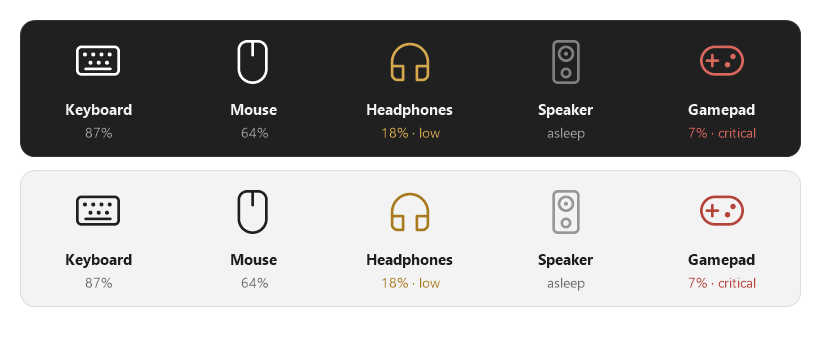

# DeviceBatteryTray

**Battery levels of your wireless keyboard, mouse, headphones and speakers, right in the Windows taskbar.**



## Features

- **One icon per device.** A keyboard looks like a keyboard, a mouse like a mouse, in the same
  style as the Windows system icons.
- **Colour only when it matters.** Amber when the battery is low, red when it is critical.
- **Exact level on hover.** The tooltip shows the percentage and when it was last read.
- **Gentle on batteries.** A sleeping device is never woken up just to read its level.
- **Private.** No internet access, no telemetry, no automatic updates.

## Languages

English, Français, Español, Deutsch, Русский, Українська, Беларуская.

The app follows the Windows display language and falls back to English. You can switch at any
time from the menu: **Language**.

## Getting started

1. Install the [.NET 10 SDK](https://dotnet.microsoft.com/download/dotnet/10.0).
2. Build the app. The repository contains source code only, so this step creates the exe:

   ```powershell
   dotnet publish src/DeviceBatteryTray/DeviceBatteryTray.csproj -c Release -r win-x64 --self-contained false -p:PublishSingleFile=true -o dist
   ```

3. Copy `dist\DeviceBatteryTray.exe` to `C:\Program Files\DeviceBatteryTray\` and start it.
4. Windows 11 hides new tray icons at first. Turn them on in
   **Settings > Personalization > Taskbar > Other system tray icons**.
5. Click any icon for the menu: refresh, choose which devices to show, change an icon type,
   start with Windows, language.

## Which devices work

- Bluetooth devices whose battery level Windows already shows in **Settings > Bluetooth & devices**.
- Devices that report their battery through the standard HID battery field, for example the
  Keychron K2 over Bluetooth.

Devices that need a vendor-specific protocol are not supported yet.

## For developers

```powershell
dotnet test DeviceBatteryTray.slnx
```

How it works, security guarantees and the code map: [docs/TECHNICAL.md](docs/TECHNICAL.md).

## License

[MIT](LICENSE)
